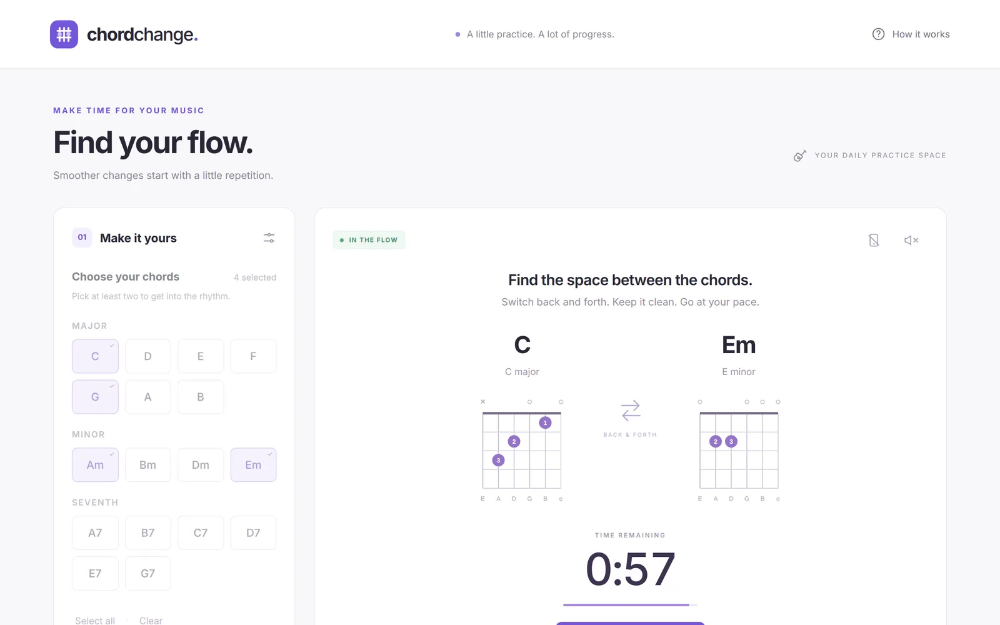
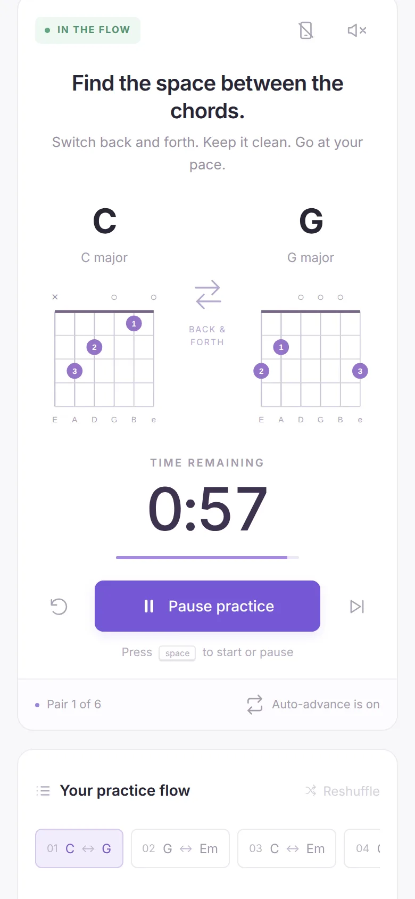

# Chord Change

[](https://github.com/ali-raheem/chord-change/actions/workflows/ci.yml) [](https://github.com/ali-raheem/chord-change/actions/workflows/pages.yml)

**▶ Try it live: [shoryuken.me/cc](https://shoryuken.me/cc/)** · mirror on [GitHub Pages](https://ali-raheem.github.io/chord-change/) · installable, works offline

<p align="center">
  <a href="https://shoryuken.me/cc/"></a>
  <a href="https://shoryuken.me/cc/"></a>
</p>

A focused guitar chord change practice app. Select chords, set the time per pair, and practice every unique pair in a shuffled order. Alternate back and forth between the displayed diagrams until the timer advances.

## Run

Requires Node.js 20 or newer. No dependencies or install step.

```sh
npm start
```

Open http://localhost:5173. Set `PORT` to use another port. The app can also be hosted on any static web server. Run `npm run release` to build `dist/`, which holds every shipped file (listed in `shipped-files.js`) with the git commit and UTC build time stamped into `version.js`, and host the contents of `dist/`. Host these together at the domain root or in a subdirectory with a trailing slash (for example `/cc/`). Asset URLs, the manifest, and service worker scope follow that directory.

## Features

- 17 common guitar chords with finger positions, open/muted strings, and barre diagrams
- Every unique unordered chord pair once per session (both directions practiced within a pair)
- 30, 60, or 90 seconds per pair, or a custom duration from 5 to 600 seconds
- Automatic advancement, pause/resume, skip, end session, and reshuffle
- Queue, session progress, and completion summary
- Optional sound cues: a gentle chime when each new pair starts, a brighter one when the session is complete
- Optional keep-awake so a phone screen does not dim during practice
- Keyboard controls, accessible diagrams, responsive layout, and saved settings
- Installable app with offline practice after the first successful online load; asks the browser to keep offline data persistent
- Version, build time, and offline-storage status shown discreetly under the page footer
- No accounts or external assets

Timer position is calculated from elapsed wall-clock time so delayed browser callbacks catch up to the correct pair. Pausing freezes the session; a background tab continues to count elapsed time. Audible cues depend on browser background audio policies.

Keep-awake uses the Screen Wake Lock API. It needs HTTPS (or `localhost`) and is held only while a session is running or paused; the browser releases it when the tab is hidden and the app re-requests it when the tab returns. On browsers without the API the button is disabled.

## Test

```sh
npm test
```


## Install on Android with Chrome

Deploy the app files to an **HTTPS** website, or serve the Node app behind an HTTPS reverse proxy. The local Node server itself serves HTTP; an Android phone visiting a plain `http://192.168…:5173` LAN address will not meet Chrome’s secure-origin install requirements. `localhost` is allowed for development; Android USB port forwarding can expose the development server as localhost on the phone.

1. Open the HTTPS site in Chrome on Android and let it finish loading.
2. Tap **Install app** in the app when Chrome makes it available, or use Chrome’s menu → **Add to home screen** → **Install** (menu wording varies).
3. Confirm the Android installation prompt. Launch Chord Change from your app launcher; it opens in its own standalone window.

Chrome controls when the install prompt is available, including engagement and already-installed checks. A previous home-screen shortcut can be removed once the app is installed. Installation does not require a Play Store listing.

The manifest provides a stable app ID (`/chordchange`, which Chrome resolves against the origin, so it is independent of the hosting folder and distinct from `start_url`), standalone display mode, 192px and 512px PNG icons, and a separate maskable Android icon. The service worker caches all files needed for practice. After the first successful cache, opening the app, chord references, timer, and saved settings work offline.

### Deploying updates

Bump `CACHE_VERSION` in `sw.js` whenever any cached app file changes, update the stylesheet version query in `index.html` when CSS changes, and deploy the app files and worker together. The next online visit downloads the updated app into a new cache. The new worker waits until all existing app windows/tabs are closed before taking over; it does not force a reload during practice. Obsolete Chord Change caches are then removed. Keep `sw.js` revalidating (`Cache-Control: no-cache`); the included server already does this.

Chrome requirements: https://web.dev/articles/install-criteria


## Licence

[MIT](LICENSE) © 2026 Ali Raheem.
